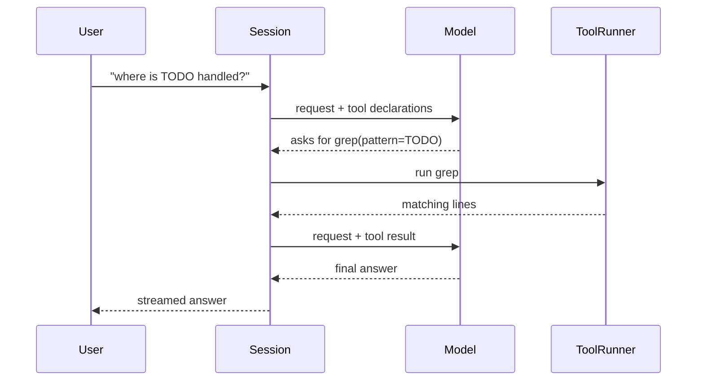
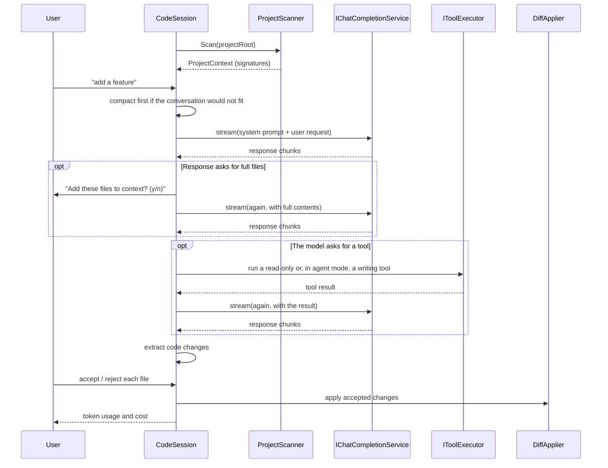

# Codai

> 🤖 **AI coding agent for your terminal.**

Codai is an AI code assistant that works from the **full context of your project**.
It summarises your codebase, holds a session-based conversation, proposes changes and
applies the ones you accept — all from the terminal.


## ✨ Features

⚡ Supports a wide range of LLMs — OpenAI, Azure OpenAI, Anthropic, Gemini, Mistral, Grok, DeepSeek, Qwen, OpenRouter and Ollama.

🧠 Context-aware assistance built from a summary of your whole project.

�️ Agent tools — `read_file`, `list_files`, `glob` and `grep` let the assistant read the
files it actually needs instead of only reasoning over the summary. Write tools let it
make the change, and every write or command asks you first.
📄 Project instructions — an `AGENTS.md`, `CLAUDE.md` or `.codai/instructions.md` file in
the repository steers every request of the session.

🧩 Project skills and commands — a `SKILL.md` the model fetches when it applies, and
`:commands` that expand a reviewed prompt into a request.

📎 `@` references — `@src/Foo.cs`, `@src/` or `@**/*.cs` in a request attaches those files
to that request, without waiting for the model to ask for them.

🧹 Long sessions stay affordable — the conversation is summarised automatically before it
outgrows the model's context window, `:compact` does it on demand, and `--continue` picks
that conversation up again next time.
�📊 Maintains conversational and code context per session.

🌳 Summarises full project context by extracting code signatures.

➕ Adds new features or test cases.

🔄 Refactors code structure and efficiency.

🐛 Describes and suggests fixes for bugs.

✅ Reviews and optimises code quality.

✔️ Accepts and applies AI-generated code changes.

📚 Generates documentation.

🌐 Works with C#, Go, Python, Java, JavaScript and TypeScript.

⚙️ Configurable via file, environment variables or CLI flags.

🗂️ Lets the AI modify several files in one response.

💳 Tracks token consumption and estimated cost per request.

## 🚀 Get started

Requires the [.NET SDK 10.0](https://dotnet.microsoft.com/download) or later.

```bash
dotnet build
dotnet run --project src/Codai.Cli -- code
```

Or publish a standalone binary:

```bash
dotnet publish src/Codai.Cli -c Release -o ./out
./out/codai code
```

### Zero setup

Set your API key once and it just works:

```bash
export API_KEY="your_api_key"
codai code
```

> [!IMPORTANT]
> Codai defaults to a sensible model per provider, so `--provider` alone is usually
> enough. DeepSeek always defaults to `deepseek-flash`. Use `--model` to choose a
> different model for the selected provider.
> *   [OpenAI](https://platform.openai.com/docs/api-reference/introduction)
> *   [Ollama](https://github.com/ollama/ollama/blob/main/docs/api.md)
> *   [Azure OpenAI](https://learn.microsoft.com/en-us/azure/ai-services/openai/reference)
> *   [Anthropic](https://docs.anthropic.com/en/api/getting-started)
> *   [Gemini](https://ai.google.dev/docs)
> *   [Mistral](https://docs.mistral.ai/)
> *   [Grok](https://docs.x.ai/docs)
> *   [Qwen](https://help.aliyun.com/zh/dashscope/developer-reference/overview)
> *   [DeepSeek](https://platform.deepseek.com/docs)
> *   [OpenRouter](https://openrouter.ai/docs/quick-start)

### ▶️ How to run

Navigate to the directory you want to analyse and start a session:

```bash
codai code
```

Each interaction is part of a session, so the assistant keeps the project and
conversation context across your requests.

## 🔧 Configuration

Configuration is resolved in increasing order of precedence:

**defaults → config file → environment variables → CLI flags**

Add a `codai-config.yml` to the root of the project you want to analyse:

```yml
ai_provider_config:
  provider: "deepseek"
  base_url: "https://api.deepseek.com"   # optional, provider default applies
  model: "deepseek-flash"                # optional, provider default applies
  api_key: "sk-..."                      # prefer the API_KEY env var
  api_version: "2023-06-01"              # optional, Anthropic only (see note)
  temperature: 0.2                       # optional
  reasoning_effort: "low"                # optional: low | medium | high
  max_tokens: 4096                       # optional
  stream: true                           # optional, default true
theme: "dracula"
```

If no config file is provided, the defaults are used. `.yml`, `.yaml` and `.json` are
all supported.

> [!NOTE]
> `api_version` is currently honoured by Anthropic only, where it is sent as the
> `anthropic-version` header. The Azure OpenAI SDK used by Codai pins the API version
> itself and does not expose a way to override it, so the setting has no effect for
> `azure-openai`.

You can also point at a config file from anywhere, or override settings inline:

```bash
codai code --config ./codai-config.yml
codai code --provider deepseek --temperature 0.8
```

### Environment variables

`API_KEY`, `PROVIDER`, `BASE_URL`, `MODEL`, `TEMPERATURE`, `REASONING_EFFORT`,
`MAX_TOKENS`, `API_VERSION`, `THEME`.

Nested keys can also be supplied with the `__` separator, e.g.
`AI_PROVIDER_CONFIG__MODEL=deepseek-flash`.

### CLI flags

Flags use kebab-case. Underscores are accepted wherever a dash is, so the older snake_case
spellings (`--base_url`, `--api_key`, `--api_version`, `--max_tokens`, `--reasoning_effort`,
`--no_shell`) keep working.

```
codai code [options]

  -c, --config <path>        Configuration file
      --provider <name>      Chat provider
      --base-url <url>       Provider endpoint override
      --model <name>         Model identifier
      --temperature <n>      Sampling temperature
      --reasoning-effort <l> low | medium | high
      --max-tokens <n>       Maximum output tokens
      --stream <bool>        Stream the response
      --api-key <key>        API key (prefer API_KEY)
      --api-version <v>      Version header for providers that need one (Anthropic)
      --mode <name>          ask | plan | agent (default: agent)
      --no-shell             Do not offer the model a way to run commands
      --no-auto-compact      Never summarise a conversation that grows too long
      --no-sub-agents        Do not let the model delegate a search to a sub-agent
      --continue             Resume the conversation stored for this project
  -v, --version              Print version
  -h, --help                 Print help
```

`--reasoning-effort` is forwarded to the provider as `ChatOptions.Reasoning`, so it
changes the request that is sent rather than being accepted and ignored.

`--mode` sets the mode the session starts in; `:mode` changes it at any point. The session
starts in `agent` mode — being asked before every write is what makes that safe — and
`--mode ask` or `--mode plan` starts it read-only instead. `--no-shell` keeps the file
tools but never offers the model a command to run. `--no-sub-agents` withdraws the `task`
tool, which is the only way to stop the model spending model calls of its own.

### Providers and defaults

| Provider | Default base URL | Default model |
| --- | --- | --- |
| `openai` | `https://api.openai.com/v1` | `gpt-4o` |
| `azure-openai` | `https://{your-resource}.openai.azure.com` | `gpt-4o` |
| `anthropic` | `https://api.anthropic.com/v1` | `claude-3-5-sonnet-latest` |
| `gemini` | `https://generativelanguage.googleapis.com/v1beta` | `gemini-1.5-pro` |
| `ollama` | `http://localhost:11434/api` | `llama3.1` |
| `deepseek` | `https://api.deepseek.com` | `deepseek-flash` |
| `openrouter` | `https://openrouter.ai/api/v1` | `openai/gpt-4o` |
| `qwen` | `https://dashscope.aliyuncs.com/compatible-mode/v1` | `qwen-plus` |
| `mistral` | `https://api.mistral.ai/v1` | `mistral-large-latest` |
| `grok` | `https://api.x.ai/v1` | `grok-2-latest` |

> **DeepSeek always defaults to `deepseek-flash`** unless a model is supplied explicitly.
> Verified against the live API: base URL `https://api.deepseek.com`, model
> `deepseek-flash`. The legacy aliases `deepseek-v4-flash` and
> `deepseek-v4-flash-vision-exp` are also accepted by the platform and billed at the
> Flash price.

### Ignoring files

Create a `.codai-gitignore` in the project root using gitignore-style patterns; matching
files are excluded from the project context. `.codai/` itself is always ignored, so the
session store is never read back as if it were project context.

### Project instructions

A repository that ships an instructions file steers the whole session. The first file
found wins:

| Order | File |
| --- | --- |
| 1 | `AGENTS.md` |
| 2 | `CLAUDE.md` |
| 3 | `CODAI.md` |
| 4 | `.codai/instructions.md` |
| 5 | `.github/copilot-instructions.md` |

The file is capped at 32 KB and the one that was picked is reported at start-up
(`📄 Following project instructions from AGENTS.md`).

### Referencing files from a request

An `@` reference attaches file contents to that one request:

| Reference | Attaches |
| --- | --- |
| `@src/Foo.cs` | that file |
| `@src/` or `@src` | every file below `src/` |
| `@**/*.cs` | every file matching the glob |

References go through the same file index as the tools, so `bin/`, `obj/`,
`.codai-gitignore` matches and anything outside the project root stay out, and at most
20 files (256 KB) are attached per request. A reference that matches nothing is
reported rather than dropped, so a typo cannot silently cost you the context you asked
for.

### Continuing a session

Every turn is written to `.codai/sessions/latest.json`, which the project scan ignores.
`--continue` resumes it:

```bash
codai code --continue
```

## ⌨️ Session commands

| Command | Action |
| --- | --- |
| `:help` | List the session commands |
| `:clear` | Clear the screen |
| `:exit` | Leave the session |
| `:token` | Show token usage and estimated cost |
| `:clear-token` | Reset the token counters |
| `:clear-history` | Forget the conversation so far |
| `:mode [name]` | Show or change what the assistant is allowed to do |
| `:compact [focus]` | Replace the conversation so far with a summary of it, weighted towards `focus` |

A colon-prefixed line that is not one of these is looked up in `.codai/commands`. A name
that matches nothing is reported; it is never sent to the model as if it were a question.

### Project commands

A markdown file in `.codai/commands` becomes a `:command`. The file name is the command
name, the body becomes the request, and `$ARGUMENTS`, `$1`–`$9` are substituted:

```markdown
<!-- .codai/commands/review.md -->
---
description: Reviews the working tree against the project's conventions
argument-hint: <path> [<path> ...]
---
Review the changes under $ARGUMENTS against the conventions of this project. Read the
files first, then list what should change and why.
```

```
> :review src/Api
```

Commands are re-read on every line, so a command added or edited mid-session works
immediately. A command's description reaches the prompt, its body does not.

## 🎚️ Agent modes

A mode decides how much freedom a request has. It is read per request, so `:mode` takes
effect on the next thing you type.

| Mode | Tools offered | Behaviour |
| --- | --- | --- |
| `agent` (default) | all | Reads, edits files and runs commands, and asks before each one. |
| `ask` | read-only | Answers questions. Read anything, change nothing. |
| `plan` | read-only | Investigates and answers with a numbered plan, then stops. |

```
> :mode ask
✔️ Mode is now ask. I can read anything in the project, but I won't change it.
> :mode
Mode: ask — I can read anything in the project, but I won't change it. Change it with :mode ask | plan | agent.
```

Tools are selected by their `IsReadOnly` flag, not by a list of names, and the guidance
in the prompt is generated from the same mode. So a new mutating tool cannot accidentally
be offered to `ask`, and the assistant is never told it may edit while being given no tool
that can.

A model that has no editing tool can still write a diff into its answer, which is why the
read-only modes are enforced twice: the tool is not offered, and a diff in the answer is
reported instead of applied.

```
🔒 1 change(s) proposed (src/Api/OrderService.cs) were not applied: the session is in ask mode. Use :mode agent to apply them.
```

## 🛠️ Agent tools

Codai does not stop at the project summary: the model can read the real files through
tools, and every call is reported as it happens.

| Tool | Mode | Arguments | What it does |
| --- | --- | --- | --- |
| `read_file` | any | `path`, `offset`, `limit` | Returns a numbered slice of a text file. |
| `list_files` | any | `path`, `recursive` | Lists a directory, or every file below it. |
| `glob` | any | `pattern`, `path` | Finds files by path pattern, e.g. `**/*.cs`. |
| `grep` | any | `pattern`, `path`, `include`, `case_sensitive` | Searches file contents with a regular expression. |
| `read_skill` | any | `name` | Returns a project skill's instructions. |
| `task` | any | `description`, `prompt` | Hands an investigation to a sub-agent with a context window of its own. |
| `write_file` | `agent` | `path`, `content` | Creates a file, or replaces its whole contents. |
| `edit_file` | `agent` | `path`, `old_string`, `new_string`, `replace_all` | Replaces an exact piece of a file. |
| `run_command` | `agent` | `command`, `timeout_seconds` | Runs a command line from the project root. |

The read-only tools never prompt. `write_file`, `edit_file` and `run_command` are
gated by an approval prompt showing exactly what they are about to do:

```
  • write_file(path=src/Api/Handler.cs)
Allow write_file: write_file(path=src/Api/Handler.cs) ? (y/n):
```

What every tool can see is filtered by the same ignore rules as the project scan
(`.codai-gitignore`, `bin/`, `obj/`, `node_modules/`, ...), and every path is resolved
inside the project root, so a tool cannot read, write or search outside it.

> [!WARNING]
> `run_command` executes arbitrary command lines with **your** privileges. There is no
> sandbox. It is only registered when a host opts in (`AddCodaiTools(allowShell: true)`,
> which the CLI does unless you pass `--no-shell`), it always asks for approval, and it
> runs from the project root. Review the command line in the prompt before answering `y`.

### Tool budgets

An agent that calls tools in a loop can spend a whole context window without ever
answering. Two limits are enforced per request: at most 60 calls, and at most two
identical calls. Repeated *different* calls — reading twenty files in a row — are not
restricted. When a limit is hit the model is told to answer with what it has, saying what
is still unverified.

### Sub-agents

Finding something out can cost more context than the answer is worth. "Where is the auth
token validated?" may mean reading forty files, and those forty file bodies would then sit
in the conversation for the rest of the session, re-sent on every request.

`task` is how the model avoids paying that. It hands the question to a sub-agent with a
**context window of its own**: the sub-agent searches, reads and greps, then reports back
in a few hundred words. Its reading never enters this conversation — only the report does.

```
> why does the retry test fail?
  • task(description=Why does the retry test fail?, prompt=Start at RetryPolicyTests.cs)
⏳ Sub-agent: Why does the retry test fail?
```

Four properties make it safe to allow in every mode:

- **Read-only.** A sub-agent is only given the tools that report `IsReadOnly`. Delegating
  can never be a way round the session's mode, and the executor it runs through is built
  with the deny-all approver as well, so a mistake in that filter fails closed.
- **No nesting.** The sub-agent is never offered `task` itself, so a run cannot branch.
- **Its own budget.** At most 30 tool calls per run, against 60 for a user request.
- **Counted.** What the run spends is added to the session totals, so `:token` stays
  honest — whether or not the run produced a report.

A run that fails, or that returns nothing, comes back as a failed tool call the parent can
read and work around rather than an exception that ends the turn. Reports are cut at
4,000 characters and say so.

Off with `--no-sub-agents`, or `AddCodaiSession(..., allowSubAgents: false)` in a host that
would rather not spend model calls it did not ask for.

Tool calling works on every provider. The OpenAI-compatible ones (OpenAI, Azure OpenAI,
DeepSeek, Mistral, Grok, Qwen, OpenRouter, Ollama) go through `Microsoft.Extensions.AI`;
Anthropic and Gemini have hand-written tool support for their own wire formats.



## 🧩 Project customization

Everything a project contributes to the prompt lives in `.codai/`:

| Path | What it is |
| --- | --- |
| `.codai/commands/<name>.md` | A `:command` the user can type. |
| `.codai/skills/<name>/SKILL.md` | Instructions the model fetches with `read_skill` when they apply. |
| `.codai/sessions/latest.json` | The stored conversation, resumed by `--continue`. |
| `.codai/instructions.md` | Fallback project instructions. |

A skill reaches the prompt as one line — its name and description — and its body is
fetched only when the model decides the skill applies. A project with thirty skills
therefore costs thirty lines instead of thirty documents:

```
## Here are the skills available in this project

These skills are available. Read one with the read_skill tool when its description matches
what you are about to do, and follow it.

- ef-migrations: How this project writes and reviews EF Core migrations.
```

## 🗜️ Long conversations

A conversation that outgrows the model's context window is summarised before it is sent,
so a long session keeps working instead of failing on the request it cannot fit.

The decision is made from an estimate of the request that is about to be sent, compared
against the model's window minus a reserve for the response, the tool definitions and the
next turn. Estimating errs high and the reserve is large, so compaction happens slightly
early rather than too late.

```
> summarize the auth flow
📉 This conversation needs about 118,400 of the 128,000 tokens claude-3-5-sonnet-latest
can hold. Summarising it first.
✔️ Compacted 14 turn(s) into one summary.
```

| Knob | Where | Default |
| --- | --- | --- |
| Automatic compaction | `SessionOptions.AutoCompact`, `--no-auto-compact` | on |
| Reserve kept free | `CompactionPolicy.ReserveTokens` | 13,000 tokens |
| Failures before giving up | `CompactionPolicy.MaxFailures` | 3 |

Summarising is itself a model call, so it can fail. After three consecutive failures the
session stops trying and carries the long history instead: a long conversation that still
works beats one stuck trying to shorten itself. `:compact` always works on demand, and
`:clear-history` starts the conversation over.

`:compact` also takes the thing you want the summary to keep, which is the difference
between a summary that is merely correct and one that is useful for the next request:

```
> :compact the file paths and the failing test names
✔️ Compacted 22 turn(s) into one summary.
```

The same machinery keeps the prompt small in the other direction: project instructions
are re-sent on every request, so they survive a compaction.

## 🏗️ Project layout

| Project | Responsibility |
| --- | --- |
| `src/Codai.Core` | Domain types, abstractions and first-party services: `Agents` (modes and their policy), `Context` (windows, token estimate, compaction policy), `Customization` (commands and skills), `Chat`, `Diffs`, `Tokens`, `Projects`, `Prompting`, `IO`, plus an `Abstractions` folder. No dependencies beyond DI abstractions. |
| `src/Codai.Configuration` | `codai-config.yml\|yaml\|json` loading, environment variables, CLI flag parsing, the provider catalog and its defaults. |
| `src/Codai.Tokens` | Embedded `model_pricing.json` catalog and cost calculation. |
| `src/Codai.Providers` | `IChatCompletionService` implementations for all providers, built on `Microsoft.Extensions.AI`. |
| `src/Codai.Analysis` | Project scanner, Roslyn C# signature extractor, regex extractors for Go/Python/Java/JS/TS, ignore rules. |
| `src/Codai.Tools` | The agent tools (`read_file`, `list_files`, `glob`, `grep`, `read_skill`, `task`, `write_file`, `edit_file`, `run_command`) and the glob matcher and project index they share. |
| `src/Codai.Session` | Session orchestration: `CodeSession`, `ProjectContextLoader`, `ProjectGuidanceLoader`, `ChatExchangeService`, `UserCommandResolver`, `AutoCompactor`, `ChangeApplicator`, `SessionCommandHandler`, `SubAgentRunner`. |
| `src/Codai.Cli` | `codai` executable: argument handling, Spectre.Console user interface, DI composition. |
| `tests/*` | xUnit + FluentAssertions test projects, one per component. |

### Design notes

- **Abstractions first.** Every collaborator is an interface in an `Abstractions`
  folder (`IProjectScanner`, `IPromptBuilder`, `IChatCompletionService`,
  `IDiffApplier`, `IUserInterface`, `IChatClientFactory`, `IPricingCatalog`, …) so the
  whole session can be tested without a network or a disk.
- **One provider catalog.** `ProviderCatalog` is the single source of truth for base
  URLs, default models, wire format and whether a credential is required. Both the
  configuration layer and the client factory read it, so they cannot drift apart.
- **One way out.** The model reaches the file system through `IToolExecutor` and
  nothing else, so the provider layer never learns how approval, progress reporting or
  path containment work.
- **Capability decides access.** A mode's tool set is derived from `ITool.IsReadOnly`, and
  the prompt guidance is derived from the same mode, so the two cannot contradict each
  other or drift when a tool is added.
- **Measured, then decided.** `ContextBudget` measures a request against a window and
  `CompactionPolicy` decides what to do about it. Keeping them apart makes the threshold
  testable without running a session or calling a model.
- **Modes are state, not configuration.** `AgentModeState` holds the running mode so a
  request always reads the mode the user last asked for, instead of a copy captured when a
  service was built.
- **Source-generated JSON.** All serialization uses `JsonSerializerContext`, keeping the
  binary trim/AOT friendly.
- **Locale independent.** Number and date formatting in prompts uses
  `CultureInfo.InvariantCulture`, so output does not change with the host locale.
- **Central package management.** Versions live in `Directory.Packages.props`; projects
  reference packages without versions.
- **Reproducible packages.** Deterministic builds, SourceLink, symbol packages and XML
  documentation are configured once in `Directory.Build.props` and
  `Directory.Build.targets`; the analyzer and style rules live in `.editorconfig`.

### How the session works



## 🧪 Tests

```bash
dotnet test
```

**666 tests** covering the core, configuration, pricing, providers, analysis, session,
tools and CLI — of which three are the opt-in live DeepSeek tests. The suite is
warning-clean, and CI builds with `-warnaserror`.

### Live integration tests

The DeepSeek integration tests are opt-in and never run by default:

```bash
export API_KEY="your_deepseek_key"
export CODAI_RUN_INTEGRATION=1
dotnet test tests/Codai.Providers.Tests --filter FullyQualifiedName~DeepSeekLiveTests
```

Set `DEEPSEEK_MODEL` to override the model used by that test.

> [!NOTE]
> These assertions read `API_KEY` from the environment. Windows environment variables are
> inherited at process start, so a shell opened *before* the variable changed keeps the
> stale value — open a new terminal after changing it.

### Parity tests

`tests/Codai.Core.Tests/PromptParityTests.cs` re-implements the original Go
`GeneratePrompt` and `AddToHistory` formatting and asserts the prompt builder produces a
byte-identical string. `PricingParityTests` does the same for the pricing catalog.

Both compare against frozen copies of the original Go artifacts, embedded into the test
assembly from `tests/Codai.Core.Tests/Golden/`. The tests fail loudly if a golden is
missing, so prompt and pricing drift can never go unnoticed.

## 📦 Packaging

Every library packs as a standalone NuGet package with a symbol package alongside it,
and the CLI packs as a .NET tool:

```bash
dotnet pack Codai.slnx -c Release
dotnet tool install --global Codai.Tool    # once published to nuget.org
```

The CLI also publishes as a single framework-dependent binary, and is trim/AOT
compatible:

```bash
dotnet publish src/Codai.Cli -c Release -o ./out
```

## 🤝 Contributing

See [CONTRIBUTION.md](./CONTRIBUTION.md) for build and test instructions, and
[SECURITY.md](./SECURITY.md) for how to report a vulnerability. Changes are recorded in
[CHANGELOG.md](./CHANGELOG.md).

## 🗺️ Plan

🌀 This project is a work in progress; new features will be added over time. 🌀

Feature requests and bugs are tracked in [Issues](https://github.com/meysamhadeli/codai/issues).

# 🌟 Support

If you like this work, feel free to ⭐ this repository. Thanks a bunch for supporting me!

## 🤝 Contribution

Thanks to all [contributors](https://github.com/meysamhadeli/codai/graphs/contributors) — you're awesome, and this wouldn't be possible without you!

Please follow the [contribution guideline](./CONTRIBUTION.md) to submit a pull request or create an issue.

## 📄 License

[Apache 2.0](./LICENSE)
