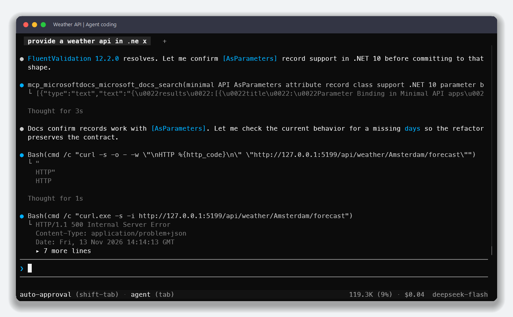

<p align="center">
  
</p>

<p align="center">
The open source coding agent for your terminal.
</p>

<br>

<p align="center">
  
</p>

---

## Installation

```bash
dotnet tool install --global codai
```

## Documentation
For full instructions on how to use Codai, see the [docs](https://meysamhadeli.github.io/codai).

## What it does

| Capability | How it helps |
| --- | --- |
| **Plan, then act** | Read and search without changing files or running commands; switch to Agent for implementation. |
| **Project-wide edits** | Read, search, and edit real files with your project's guidance in context. |
| **Scoped instructions** | Combine standard instruction files, refresh each request, and review relevant nested guidance before file tools, including read-only subagents. [Project instructions](https://meysamhadeli.github.io/codai/customization/instructions). |
| **On-demand context** | Open sessions without a full-project indexing pass; discover files through tools as needed. |
| **Workspace trust** | Review directory access before every CLI launch with Yes selected first; No or Escape declines. Scripted runs require `--trust-directory`; tool approvals stay separate. [Permissions](https://meysamhadeli.github.io/codai/usage/permissions). |
| **Controlled execution** | Validate tool arguments and bound repeated calls. Interactive terminals start with auto approval; use Shift+Tab or `--auto-approve false` to review writes and commands. Headless runs require explicit approval. |
| **Focused terminal UI** | Read numbered, syntax-colored code panes; scroll the transcript and expand action steps, command output, and file diffs. |
| **Terminal commands** | Stay in one conversation screen; use `/session` to switch saved chats and `/settings` for configuration and runtime views. Browse numbered model, agent, and theme menus, matching multi-select Skills and MCP managers, full-screen diffs, and the settings action palette. Menus share a concise Enter/Escape footer. [Command reference](https://meysamhadeli.github.io/codai/usage/terminal#slash-commands). |
| **Your choice of models** | Connect hosted providers or local servers, including Ollama. |
| **Configuration and state** | Keep runtime settings and discovery metadata in configuration; Codai manages per-project MCP/skill selections in private state. [Configuration](https://meysamhadeli.github.io/codai/customization/configuration). |
| **Reusable workflows** | Match checked skill descriptions to your task in foreground and read-only subagents, loading relevant instructions on demand. Include shared repository, personal, and nested skills with invocation/path metadata. Manage availability in `/skills`; manual workflows remain in `/` completion. [Skills](https://meysamhadeli.github.io/codai/skills). |
| **Long-running work** | Budget context for the selected model, compact growing tool output between model calls, summarize with `/compact`, and adjust windows with `/autocompact`. Resume with `codai code --continue`. [Context](https://meysamhadeli.github.io/codai/usage/context). |
| **Extensible tools** | Read layered and VS Code-style MCP definitions; open interactive workspaces without waiting for MCP connections, then connect enabled servers on the first model request and discover relevant schemas on demand. Add .NET plugins and hooks under the same approval policy. [MCP](https://meysamhadeli.github.io/codai/mcp). |

## Supported providers

Connect through `codai auth`, or select a provider with `--provider` and a model with
`--model`.

| Provider | `--provider` | Hosting | Default model |
| --- | --- | --- | --- |
| OpenAI | `openai` | Cloud | `gpt-5.4-mini` |
| Azure OpenAI | `azure-openai` | Cloud | Your deployment ID |
| Anthropic | `anthropic` | Cloud | `claude-sonnet-4-6` |
| Google Gemini | `gemini` | Cloud | `gemini-3.8-flash` |
| Ollama | `ollama` | Local | `qwen3-coder` |
| DeepSeek | `deepseek` | Cloud | `deepseek-flash` |
| OpenRouter | `openrouter` | Cloud | `openai/gpt-5.4-mini` |
| Qwen (DashScope) | `qwen` | Cloud | `qwen3.7-plus` |
| Mistral | `mistral` | Cloud | `mistral-large-4` |
| Grok (xAI) | `grok` | Cloud | `grok-4.7` |

Hosted providers require API credentials. Local Ollama does not require an API key.
OpenAI also supports **Continue with ChatGPT** for eligible accounts through `codai auth`;
account-plan access and API credentials are separate connections.
Model availability and coding-tool support depend on the selected provider and model.
Setup fetches live model catalogs, with bundled suggestions when discovery is unavailable.
See [model selection and compatibility](https://meysamhadeli.github.io/codai/providers/models).
Bundled model choices include provider-specific USD estimates and prompt-length tiers;
see [pricing coverage and limitations](https://meysamhadeli.github.io/codai/providers/pricing).

## Documentation

Documentation uses **Nextra**, with Codai's default blue, light/dark themes, local
full-text search, and guided setup. GitHub Actions builds and publishes the static site
to **GitHub Pages** when documentation changes reach `main`; no hosted docs account is
required. See [documentation development](CONTRIBUTION.md#documentation) for local preview.

| Guide | Covers |
| --- | --- |
| [Overview](https://meysamhadeli.github.io/codai) | Introduction to Codai |
| [Quickstart](https://meysamhadeli.github.io/codai/getting-started/quickstart) | Installation, model connection, and your first session |
| [Plan and Agent](https://meysamhadeli.github.io/codai/agent-mode) | Read-only investigation and deliberate implementation |
| [Tools](https://meysamhadeli.github.io/codai/usage/tools) | Built-in capabilities, limits, and tool access |
| [Terminal](https://meysamhadeli.github.io/codai/usage/terminal) | Composer, shortcuts, action steps, and diffs |
| [Permissions](https://meysamhadeli.github.io/codai/usage/permissions) | Approval policy and unattended execution |
| [Sessions and recovery](https://meysamhadeli.github.io/codai/usage/sessions) | Saved conversations, tasks, and checkpoints |
| [Providers and models](https://meysamhadeli.github.io/codai/providers) | Connections, model selection, usage, and pricing |
| [Configuration](https://meysamhadeli.github.io/codai/customization/configuration) | Saved settings, scopes, and overrides |
| [Project instructions](https://meysamhadeli.github.io/codai/customization/instructions) | Repository conventions, rules, and memory |
| [CLI reference](https://meysamhadeli.github.io/codai/resources/cli) | Entry points, flags, and exit codes |
| [Troubleshooting](https://meysamhadeli.github.io/codai/resources/troubleshooting) | Setup, models, permissions, and terminal issues |
| [Skills](https://meysamhadeli.github.io/codai/skills) | Project and global skills |
| [Plugins](https://meysamhadeli.github.io/codai/plugins) | Custom tools and lifecycle hooks |
| [MCP integrations](https://meysamhadeli.github.io/codai/mcp) | External tool servers |
| [ACP compatibility](https://meysamhadeli.github.io/codai/acp-compatibility) | Supported editor integration and current limits |
| [Roadmap](https://meysamhadeli.github.io/codai/agent-mode-roadmap) | Planned VS Code extension and editor workflows |

## Contributing

Bug reports, feature requests and pull requests are welcome. Start with
[CONTRIBUTION.md](CONTRIBUTION.md); report security issues through

## License

[Apache 2.0 © 2026 Codai contributors](./LICENSE)
