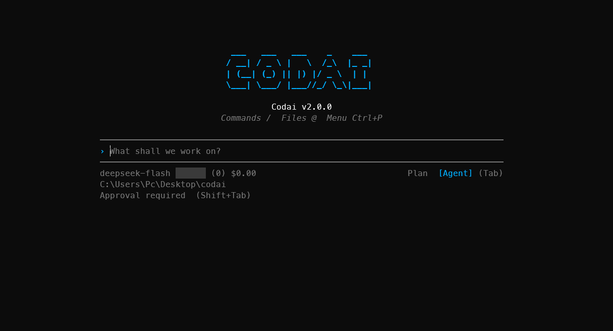

<p align="center">
  
</p>

<p align="center">
The open source coding agent for your terminal.
</p>

<div align="center">
<table>
<tbody>
<td align="center">
<a href="https://meysamhadeli.github.io/codai" target="_blank"><strong>Docs</strong></a>
</td>
<td align="center">
<a href="https://github.com/meysamhadeli/codai/discussions" target="_blank"><strong>Discussions</strong></a>
</td>
<td align="center">
<a href="https://github.com/meysamhadeli/codai/issues" target="_blank"><strong>Issues</strong></a>
</td>
<td align="center">
<a href="CONTRIBUTION.md" target="_blank"><strong>Contributing</strong></a>
</td>
</tbody>
</table>
</div>

<br>

<p align="center">
  
</p>

---

Explore a codebase, plan a change, and work across files with explicit approval for writes
and commands. Start read-only in Plan mode, then switch to Agent when you are ready to build.

## Installation

Requires the [.NET SDK 10.0](https://dotnet.microsoft.com/download) or later.

```bash
dotnet tool install --global Codai
```

## Usage

Run from your project directory:

```bash
codai       # First run: choose theme, provider, and model; later runs open chat
codai auth  # Change the connection or selected model
```

New setups save user-wide defaults in `~/.codai/codai-config.json` when no project
configuration exists. See [first-run setup](https://meysamhadeli.github.io/codai/agent-mode#connection-setup).

## What it does

| Capability | How it helps |
| --- | --- |
| **Plan, then act** | Read and search without changing files or running commands; switch to Agent for implementation. |
| **Project-wide edits** | Read, search, and edit real files with your project's guidance in context. |
| **On-demand context** | Open sessions without a full-project indexing pass; discover files through tools as needed. |
| **Controlled execution** | Review writes and commands under your approval policy. Shell commands require shell access. |
| **Focused terminal UI** | Scroll the transcript with input pinned; expand action steps, command output, and file diffs. |
| **Your choice of models** | Connect hosted providers or local servers, including Ollama. |
| **Reusable workflows** | Apply project guidance, rules, skills, commands, and memory documents. |
| **Long-running work** | Compact context and resume a previous session with `codai code --continue`. |
| **Extensible tools** | Add MCP servers, .NET plugins, and lifecycle hooks under the same approval policy. |

## Supported providers

Connect through `codai auth`, or select a provider with `--provider` and a model with
`--model`.

| Provider | `--provider` | Hosting | Default model |
| --- | --- | --- | --- |
| OpenAI | `openai` | Cloud | `gpt-5.4-mini` |
| Azure OpenAI | `azure-openai` | Cloud | Your deployment ID |
| Anthropic | `anthropic` | Cloud | `claude-sonnet-4-6` |
| Google Gemini | `gemini` | Cloud | `gemini-3.8-flash` |
| Ollama | `ollama` | Local | `qwen3-coder` |
| DeepSeek | `deepseek` | Cloud | `deepseek-flash` |
| OpenRouter | `openrouter` | Cloud | `openai/gpt-5.4-mini` |
| Qwen (DashScope) | `qwen` | Cloud | `qwen3.7-plus` |
| Mistral | `mistral` | Cloud | `mistral-medium-3-5` |
| Grok (xAI) | `grok` | Cloud | `grok-4.7` |

Hosted providers require API credentials. Local Ollama does not require an API key.
OpenAI also supports **Continue with ChatGPT** for eligible accounts through `codai auth`;
account-plan access and API credentials are separate connections.
Model availability and coding-tool support depend on the selected provider and model.
Setup fetches live model catalogs, with bundled suggestions when discovery is unavailable.
See [model selection and compatibility](https://meysamhadeli.github.io/codai/agent-mode#provider-models).
Bundled model choices include provider-specific USD estimates and prompt-length tiers;
see [pricing coverage and limitations](https://meysamhadeli.github.io/codai/agent-mode#api-cost-estimates).

## Documentation

Documentation uses **Nextra**, with Codai's default blue, light/dark themes, local
full-text search, and guided setup. GitHub Actions builds and publishes the static site
to **GitHub Pages** when documentation changes reach `main`; no hosted docs account is
required. See [documentation development](CONTRIBUTION.md#documentation) for local preview.

| Guide | Covers |
| --- | --- |
| [Overview](https://meysamhadeli.github.io/codai) | Introduction to Codai |
| [Quickstart](https://meysamhadeli.github.io/codai/getting-started/quickstart) | Installation, model connection, and your first session |
| [Agent mode](https://meysamhadeli.github.io/codai/agent-mode) | Modes, approval policy, terminal controls, and session recovery |
| [Skills](https://meysamhadeli.github.io/codai/skills) | Project and global skills |
| [Plugins](https://meysamhadeli.github.io/codai/plugins) | Custom tools and lifecycle hooks |
| [MCP integrations](https://meysamhadeli.github.io/codai/mcp) | External tool servers |
| [ACP compatibility](https://meysamhadeli.github.io/codai/acp-compatibility) | Supported editor integration and current limits |
| [Roadmap](https://meysamhadeli.github.io/codai/agent-mode-roadmap) | Planned work and implementation status |

## Contributing

Bug reports, feature requests and pull requests are welcome. Start with
[CONTRIBUTION.md](CONTRIBUTION.md); report security issues through

## License

[Apache 2.0 © 2026 Codai contributors](./LICENSE)
