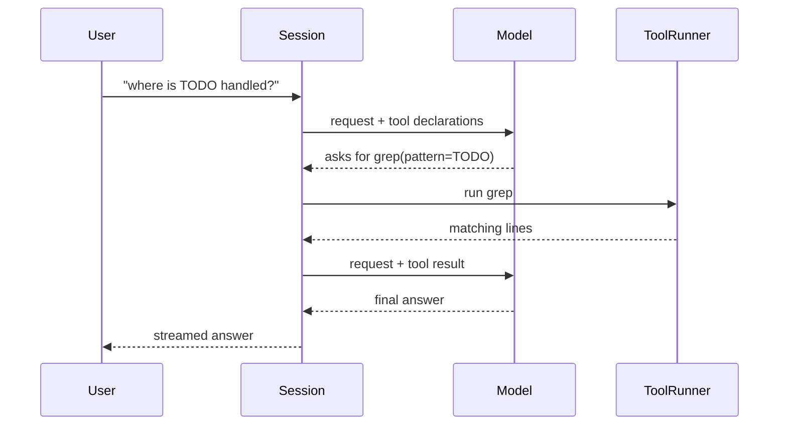
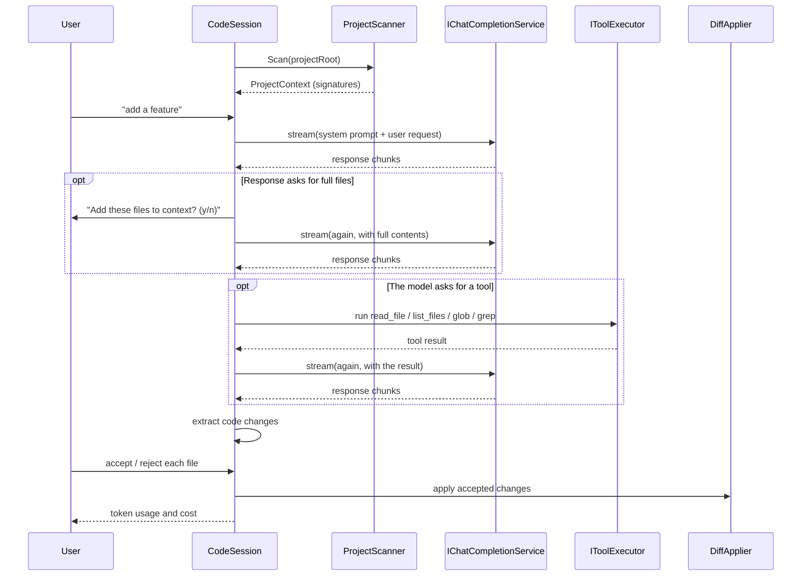

# Codai

> 🤖 **AI coding agent for your terminal.**

Codai is an AI code assistant that works from the **full context of your project**.
It summarises your codebase, holds a session-based conversation, proposes changes and
applies the ones you accept — all from the terminal.


## ✨ Features

⚡ Supports a wide range of LLMs — OpenAI, Azure OpenAI, Anthropic, Gemini, Mistral, Grok, DeepSeek, Qwen, OpenRouter and Ollama.

🧠 Context-aware assistance built from a summary of your whole project.

�️ Agent tools — `read_file`, `list_files`, `glob` and `grep` let the assistant read the
files it actually needs instead of only reasoning over the summary.

�📊 Maintains conversational and code context per session.

🌳 Summarises full project context by extracting code signatures.

➕ Adds new features or test cases.

🔄 Refactors code structure and efficiency.

🐛 Describes and suggests fixes for bugs.

✅ Reviews and optimises code quality.

✔️ Accepts and applies AI-generated code changes.

📚 Generates documentation.

🌐 Works with C#, Go, Python, Java, JavaScript and TypeScript.

⚙️ Configurable via file, environment variables or CLI flags.

🗂️ Lets the AI modify several files in one response.

💳 Tracks token consumption and estimated cost per request.

## 🚀 Get started

Requires the [.NET SDK 10.0](https://dotnet.microsoft.com/download) or later.

```bash
dotnet build
dotnet run --project src/Codai.Cli -- code
```

Or publish a standalone binary:

```bash
dotnet publish src/Codai.Cli -c Release -o ./out
./out/codai code
```

### Zero setup

Set your API key once and it just works:

```bash
export API_KEY="your_api_key"
codai code
```

> [!IMPORTANT]
> Codai defaults to a sensible model per provider, so `--provider` alone is usually
> enough. DeepSeek always defaults to `deepseek-flash`. Use `--model` to choose a
> different model for the selected provider.
> *   [OpenAI](https://platform.openai.com/docs/api-reference/introduction)
> *   [Ollama](https://github.com/ollama/ollama/blob/main/docs/api.md)
> *   [Azure OpenAI](https://learn.microsoft.com/en-us/azure/ai-services/openai/reference)
> *   [Anthropic](https://docs.anthropic.com/en/api/getting-started)
> *   [Gemini](https://ai.google.dev/docs)
> *   [Mistral](https://docs.mistral.ai/)
> *   [Grok](https://docs.x.ai/docs)
> *   [Qwen](https://help.aliyun.com/zh/dashscope/developer-reference/overview)
> *   [DeepSeek](https://platform.deepseek.com/docs)
> *   [OpenRouter](https://openrouter.ai/docs/quick-start)

### ▶️ How to run

Navigate to the directory you want to analyse and start a session:

```bash
codai code
```

Each interaction is part of a session, so the assistant keeps the project and
conversation context across your requests.

## 🔧 Configuration

Configuration is resolved in increasing order of precedence:

**defaults → config file → environment variables → CLI flags**

Add a `codai-config.yml` to the root of the project you want to analyse:

```yml
ai_provider_config:
  provider: "deepseek"
  base_url: "https://api.deepseek.com"   # optional, provider default applies
  model: "deepseek-flash"                # optional, provider default applies
  api_key: "sk-..."                      # prefer the API_KEY env var
  api_version: "2023-06-01"              # optional, Anthropic only (see note)
  temperature: 0.2                       # optional
  reasoning_effort: "low"                # optional: low | medium | high
  max_tokens: 4096                       # optional
  stream: true                           # optional, default true
theme: "dracula"
```

If no config file is provided, the defaults are used. `.yml`, `.yaml` and `.json` are
all supported.

> [!NOTE]
> `api_version` is currently honoured by Anthropic only, where it is sent as the
> `anthropic-version` header. The Azure OpenAI SDK used by Codai pins the API version
> itself and does not expose a way to override it, so the setting has no effect for
> `azure-openai`.

You can also point at a config file from anywhere, or override settings inline:

```bash
codai code --config ./codai-config.yml
codai code --provider deepseek --temperature 0.8
```

### Environment variables

`API_KEY`, `PROVIDER`, `BASE_URL`, `MODEL`, `TEMPERATURE`, `REASONING_EFFORT`,
`MAX_TOKENS`, `API_VERSION`, `THEME`.

Nested keys can also be supplied with the `__` separator, e.g.
`AI_PROVIDER_CONFIG__MODEL=deepseek-flash`.

### CLI flags

Flags use kebab-case. The older snake_case spellings (`--base_url`, `--api_key`,
`--api_version`, `--max_tokens`, `--reasoning_effort`) are still accepted as aliases.

```
codai code [options]

  -c, --config <path>        Configuration file
      --provider <name>      Chat provider
      --base-url <url>       Provider endpoint override
      --model <name>         Model identifier
      --temperature <n>      Sampling temperature
      --reasoning-effort <l> low | medium | high
      --max-tokens <n>       Maximum output tokens
      --stream <bool>        Stream the response
      --api-key <key>        API key (prefer API_KEY)
      --api-version <v>      Version header for providers that need one (Anthropic)
  -v, --version              Print version
  -h, --help                 Print help
```

`--reasoning-effort` is forwarded to the provider as `ChatOptions.Reasoning`, so it
changes the request that is sent rather than being accepted and ignored.

### Providers and defaults

| Provider | Default base URL | Default model |
| --- | --- | --- |
| `openai` | `https://api.openai.com/v1` | `gpt-4o` |
| `azure-openai` | `https://{your-resource}.openai.azure.com` | `gpt-4o` |
| `anthropic` | `https://api.anthropic.com/v1` | `claude-3-5-sonnet-latest` |
| `gemini` | `https://generativelanguage.googleapis.com/v1beta` | `gemini-1.5-pro` |
| `ollama` | `http://localhost:11434/api` | `llama3.1` |
| `deepseek` | `https://api.deepseek.com` | `deepseek-flash` |
| `openrouter` | `https://openrouter.ai/api/v1` | `openai/gpt-4o` |
| `qwen` | `https://dashscope.aliyuncs.com/compatible-mode/v1` | `qwen-plus` |
| `mistral` | `https://api.mistral.ai/v1` | `mistral-large-latest` |
| `grok` | `https://api.x.ai/v1` | `grok-2-latest` |

> **DeepSeek always defaults to `deepseek-flash`** unless a model is supplied explicitly.
> Verified against the live API: base URL `https://api.deepseek.com`, model
> `deepseek-flash`. The legacy aliases `deepseek-v4-flash` and
> `deepseek-v4-flash-vision-exp` are also accepted by the platform and billed at the
> Flash price.

### Ignoring files

Create a `.codai-gitignore` in the project root using gitignore-style patterns; matching
files are excluded from the project context.

## ⌨️ Session commands

| Command | Action |
| --- | --- |
| `:help` | List the session commands |
| `:clear` | Clear the screen |
| `:exit` | Leave the session |
| `:token` | Show token usage and estimated cost |
| `:clear-token` | Reset the token counters |
| `:clear-history` | Forget the conversation so far |

## 🛠️ Agent tools

Codai does not stop at the project summary: the model can read the real files through
tools, and every call is reported as it happens.

| Tool | Arguments | What it does |
| --- | --- | --- |
| `read_file` | `path`, `offset`, `limit` | Returns a numbered slice of a text file. |
| `list_files` | `path`, `recursive` | Lists a directory, or every file below it. |
| `glob` | `pattern`, `path` | Finds files by path pattern, e.g. `**/*.cs`. |
| `grep` | `pattern`, `path`, `include`, `case_sensitive` | Searches file contents with a regular expression. |

All four are **read-only**, so none of them asks for confirmation. What they can see is
filtered by the same ignore rules as the project scan (`.codai-gitignore`, `bin/`,
`obj/`, `node_modules/`, ...), and every path is resolved inside the project root, so a
tool cannot read or search outside it.

Tool calling works on every provider. The OpenAI-compatible ones (OpenAI, Azure OpenAI,
DeepSeek, Mistral, Grok, Qwen, OpenRouter, Ollama) go through `Microsoft.Extensions.AI`;
Anthropic and Gemini have hand-written tool support for their own wire formats.



> [!NOTE]
> A tool that writes to disk or runs a command would declare `ITool.IsReadOnly` as
> `false` and would then be gated by an approval prompt. No such tool ships yet, and the
> default approver refuses them until one is wired to a prompt.

## 🏗️ Project layout

| Project | Responsibility |
| --- | --- |
| `src/Codai.Core` | Domain types, abstractions and first-party services: `Chat`, `Diffs`, `Tokens`, `Projects`, `Prompting`, `IO`, plus an `Abstractions` folder. No dependencies beyond DI abstractions. |
| `src/Codai.Configuration` | `codai-config.yml\|yaml\|json` loading, environment variables, CLI flag parsing, the provider catalog and its defaults. |
| `src/Codai.Tokens` | Embedded `model_pricing.json` catalog and cost calculation. |
| `src/Codai.Providers` | `IChatCompletionService` implementations for all providers, built on `Microsoft.Extensions.AI`. |
| `src/Codai.Analysis` | Project scanner, Roslyn C# signature extractor, regex extractors for Go/Python/Java/JS/TS, ignore rules. |
| `src/Codai.Tools` | The agent tools (`read_file`, `list_files`, `glob`, `grep`) and the glob matcher and project index they share. |
| `src/Codai.Session` | Session orchestration: `CodeSession`, `ProjectContextLoader`, `ChatExchangeService`, `ChangeApplicator`, `SessionCommandHandler`. |
| `src/Codai.Cli` | `codai` executable: argument handling, Spectre.Console user interface, DI composition. |
| `tests/*` | xUnit + FluentAssertions test projects, one per component. |

### Design notes

- **Abstractions first.** Every collaborator is an interface in an `Abstractions`
  folder (`IProjectScanner`, `IPromptBuilder`, `IChatCompletionService`,
  `IDiffApplier`, `IUserInterface`, `IChatClientFactory`, `IPricingCatalog`, …) so the
  whole session can be tested without a network or a disk.
- **One provider catalog.** `ProviderCatalog` is the single source of truth for base
  URLs, default models, wire format and whether a credential is required. Both the
  configuration layer and the client factory read it, so they cannot drift apart.
- **One way out.** The model reaches the file system through `IToolExecutor` and
  nothing else, so the provider layer never learns how approval, progress reporting or
  path containment work.
- **Source-generated JSON.** All serialization uses `JsonSerializerContext`, keeping the
  binary trim/AOT friendly.
- **Locale independent.** Number and date formatting in prompts uses
  `CultureInfo.InvariantCulture`, so output does not change with the host locale.
- **Central package management.** Versions live in `Directory.Packages.props`; projects
  reference packages without versions.
- **Reproducible packages.** Deterministic builds, SourceLink, symbol packages and XML
  documentation are configured once in `Directory.Build.props` and
  `Directory.Build.targets`; the analyzer and style rules live in `.editorconfig`.

### How the session works



## 🧪 Tests

```bash
dotnet test
```

**414 tests** covering the core, configuration, pricing, providers, analysis, session,
tools and CLI — of which three are the opt-in live DeepSeek tests. The suite is
warning-clean, and CI builds with `-warnaserror`.

### Live integration tests

The DeepSeek integration tests are opt-in and never run by default:

```bash
export API_KEY="your_deepseek_key"
export CODAI_RUN_INTEGRATION=1
dotnet test tests/Codai.Providers.Tests --filter FullyQualifiedName~DeepSeekLiveTests
```

Set `DEEPSEEK_MODEL` to override the model used by that test.

> [!NOTE]
> These assertions read `API_KEY` from the environment. Windows environment variables are
> inherited at process start, so a shell opened *before* the variable changed keeps the
> stale value — open a new terminal after changing it.

### Parity tests

`tests/Codai.Core.Tests/PromptParityTests.cs` re-implements the original Go
`GeneratePrompt` and `AddToHistory` formatting and asserts the prompt builder produces a
byte-identical string. `PricingParityTests` does the same for the pricing catalog.

Both compare against frozen copies of the original Go artifacts, embedded into the test
assembly from `tests/Codai.Core.Tests/Golden/`. The tests fail loudly if a golden is
missing, so prompt and pricing drift can never go unnoticed.

## 📦 Packaging

Every library packs as a standalone NuGet package with a symbol package alongside it,
and the CLI packs as a .NET tool:

```bash
dotnet pack Codai.slnx -c Release
dotnet tool install --global Codai.Tool    # once published to nuget.org
```

The CLI also publishes as a single framework-dependent binary, and is trim/AOT
compatible:

```bash
dotnet publish src/Codai.Cli -c Release -o ./out
```

## 🤝 Contributing

See [CONTRIBUTION.md](./CONTRIBUTION.md) for build and test instructions, and
[SECURITY.md](./SECURITY.md) for how to report a vulnerability. Changes are recorded in
[CHANGELOG.md](./CHANGELOG.md).

## 🗺️ Plan

🌀 This project is a work in progress; new features will be added over time. 🌀

Feature requests and bugs are tracked in [Issues](https://github.com/meysamhadeli/codai/issues).

# 🌟 Support

If you like this work, feel free to ⭐ this repository. Thanks a bunch for supporting me!

## 🤝 Contribution

Thanks to all [contributors](https://github.com/meysamhadeli/codai/graphs/contributors) — you're awesome, and this wouldn't be possible without you!

Please follow the [contribution guideline](./CONTRIBUTION.md) to submit a pull request or create an issue.

## 📄 License

[Apache 2.0](./LICENSE)
