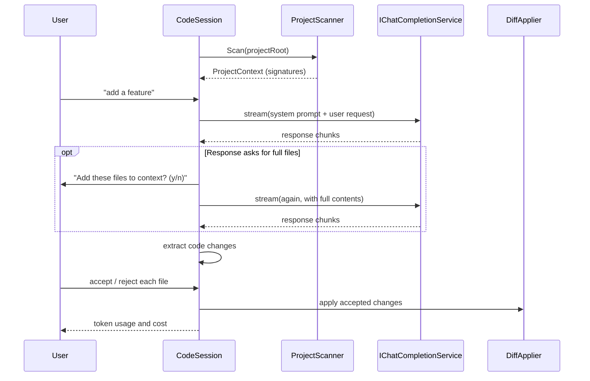

# Codai — .NET rewrite

A ground-up C# / .NET 10 rewrite of [Codai](https://github.com/meysamhadeli/codai),
the terminal AI coding agent that works from the **full context of your project**.

The original Go implementation lives at the repository root and is kept intact as the
reference. This folder is a standalone solution that reproduces the same behaviour,
prompt layout and configuration surface, with the bugs found during the port fixed.

---

## Status

| Phase | Scope | State |
| --- | --- | --- |
| 1 | Core models, abstractions, prompt builder, config, tokens/pricing | ✅ Complete |
| 2 | Providers via `Microsoft.Extensions.AI` (10 providers) | ✅ Complete |
| 3 | Project analysis: Roslyn signatures, tree-sitter-parity regex extractors, ignore rules, scanner | ✅ Complete |
| 4 | Session orchestrator, Spectre.Console UI, CLI | ✅ Complete |
| 5 | Embedded-asset parity tests + docs | ✅ Complete |
| 6 | CI workflow, non-streamed completion mode | ✅ Complete |
| 7 | DeepSeek live verification + pricing for `deepseek-flash` | ✅ Complete |

**252 tests passing** (2 optional live integration tests are skipped unless explicitly enabled).

---

## Requirements

- [.NET SDK 10.0](https://dotnet.microsoft.com/download) or later
- An API key for the provider you want to use (not required for Ollama)

---

## Getting started

```bash
cd dotnet
dotnet build
dotnet run --project src/Codai.Cli -- code
```

Install as a global tool-shaped binary:

```bash
dotnet publish src/Codai.Cli -c Release -o ./out
./out/codai code
```

### Zero-config setup

Set your API key once and run:

```bash
export API_KEY="your_api_key"
codai code
```

---

## Project layout

| Project | Responsibility |
| --- | --- |
| `src/Codai.Core` | Models, abstractions, prompt builder, chat history, token tracker, diff applier, requested-context resolver. No third-party dependencies beyond DI abstractions. |
| `src/Codai.Configuration` | `codai-config.yml\|yaml\|json` loading, environment variables, CLI flag parsing and provider defaults. |
| `src/Codai.Tokens` | Embedded `model_pricing.json` catalog and cost calculation. |
| `src/Codai.Providers` | `IChatCompletionService` implementations for all providers, built on `Microsoft.Extensions.AI`. |
| `src/Codai.Analysis` | Project scanner, Roslyn C# signature extractor, regex extractors for Go/Python/Java/JS/TS, ignore rules. |
| `src/Codai.Session` | The interactive `CodeSession` orchestrator and slash-command handling. |
| `src/Codai.Cli` | `codai` executable: argument handling, Spectre.Console user interface, DI composition. |
| `tests/*` | xUnit + FluentAssertions test projects, one per component. |

### Design notes

- **Abstractions first.** Every collaborator is an interface in `Codai.Core.Abstractions`
  (`IProjectScanner`, `IPromptBuilder`, `IChatCompletionService`, `IDiffApplier`,
  `IUserInterface`, …) so the whole session can be tested without a network or a disk.
- **Source-generated JSON.** All serialization uses `JsonSerializerContext`, keeping the
  binary trim/AOT friendly.
- **Central package management.** Versions live in `Directory.Packages.props`; projects
  reference packages without versions.

---

## Configuration

Resolution order (lowest to highest precedence): **defaults → config file → environment
variables → CLI flags**.

A `codai-config.yml` in the working directory is picked up automatically; `.yml`, `.yaml`
and `.json` are all supported.

```yml
ai_provider_config:
  provider: "deepseek"
  base_url: "https://api.deepseek.com"   # optional, provider default applies
  model: "deepseek-flash"                # optional, provider default applies
  api_key: "sk-..."                      # prefer the API_KEY env var
  api_version: "2024-04-01-preview"      # optional, Azure OpenAI / Anthropic
  temperature: 0.2                       # optional
  reasoning_effort: "low"                # optional
  max_tokens: 4096                       # optional
  stream: true                           # optional, default true
theme: "dracula"
```

### Environment variables

`API_KEY`, `PROVIDER`, `BASE_URL`, `MODEL`, `TEMPERATURE`, `REASONING_EFFORT`,
`ENCODING_FORMAT`, `MAX_TOKENS`, `API_VERSION`, `THEME`.

Nested keys can also be supplied with the `__` separator, e.g.
`AI_PROVIDER_CONFIG__MODEL=deepseek-flash`.

### CLI flags

```
codai code [options]

  -c, --config <path>        Configuration file
      --provider <name>      Chat provider
      --base_url <url>       Provider endpoint override
      --model <name>         Model identifier
      --temperature <n>      Sampling temperature
      --reasoning_effort <l> low | medium | high
      --max_tokens <n>       Maximum output tokens
      --stream <bool>        Stream the response
      --api_key <key>        API key (prefer API_KEY)
      --api_version <v>      API version
  -v, --version              Print version
  -h, --help                 Print help
```

### Providers and defaults

| Provider | Default base URL | Default model |
| --- | --- | --- |
| `openai` | `https://api.openai.com/v1` | `gpt-4o` |
| `azure-openai` | `https://{your-resource}.openai.azure.com` | `gpt-4o` |
| `anthropic` | `https://api.anthropic.com/v1` | `claude-3-5-sonnet-latest` |
| `gemini` | `https://generativelanguage.googleapis.com/v1beta` | `gemini-1.5-pro` |
| `ollama` | `http://localhost:11434/api` | `llama3.1` |
| `deepseek` | `https://api.deepseek.com` | `deepseek-flash` |
| `openrouter` | `https://openrouter.ai/api/v1` | `openai/gpt-4o` |
| `qwen` | `https://dashscope.aliyuncs.com/compatible-mode/v1` | `qwen-plus` |
| `mistral` | `https://api.mistral.ai/v1` | `mistral-large-latest` |
| `grok` | `https://api.x.ai/v1` | `grok-2-latest` |

> **DeepSeek always defaults to `deepseek-flash`** unless a model is supplied explicitly.
> Verified against the live API: base URL `https://api.deepseek.com`, model
> `deepseek-flash`. The legacy aliases `deepseek-v4-flash` and
> `deepseek-v4-flash-vision-exp` are also accepted by the platform and billed at the
> Flash price.

### Ignoring files

Create a `.codai-gitignore` in the project root using gitignore-style patterns; matching
files are excluded from the project context.

---

## Session commands

| Command | Action |
| --- | --- |
| `:help` | List the session commands |
| `:clear` | Clear the screen |
| `:exit` | Leave the session |
| `:token` | Show token usage and estimated cost |
| `:clear-token` | Reset the token counters |
| `:clear-history` | Forget the conversation so far |

---

## How the session works



---

## Tests

```bash
cd dotnet
dotnet test
```

### Live integration tests

The DeepSeek integration test is opt-in and never runs by default:

```bash
export API_KEY="your_deepseek_key"
export CODAI_RUN_INTEGRATION=1
dotnet test tests/Codai.Providers.Tests --filter FullyQualifiedName~DeepSeekLiveTests
```

Set `DEEPSEEK_MODEL` to override the model used by that test. These assertions run in a
terminal that has the current `API_KEY`: Windows environment variables are inherited at
process start, so a shell opened *before* the variable changed keeps the stale value.

### Parity tests

`tests/Codai.Core.Tests/PromptParityTests.cs` re-implements the original Go
`GeneratePrompt` and `AddToHistory` formatting and asserts the C# prompt builder
produces a byte-identical string. Both embedded assets
(`SummarizeFullContextPrompt.tmpl`, `model_pricing.json`) are byte-identical to their
Go counterparts.

---

## Differences from the Go implementation

The rewrite is behaviour-compatible but deliberately fixes several defects found while
porting. Each is covered by a test.

### Bugs fixed

1. **Provider base URLs were ignored.** Providers constructed without a `base_url`
   silently lost their default endpoint. `ProviderDefaults.ResolveBaseUrl` now applies
   the default, and the provider name is trimmed before comparison.
2. **The "requested context" retry could never fire.** In Go it was evaluated against an
   already-drained buffer before the first request ran. It now runs after the model
   responds and asks for more files.
3. **The conversation history could be polluted.** The Go flow could add history entries
   on the retry path. The C# session records exactly one history turn per user request.
4. **Diff markers were stripped too aggressively.** The Go applier stripped markers from
   any position in a line, corrupting code such as `i++`. Markers are now recognised only
   as the first non-whitespace character of a line, and exactly one character is removed.
5. **Anthropic usage was under-reported.** `input_tokens` is nested under `message.usage`
   in the `message_start` event; it is now read from the correct path.
6. **Gemini authentication used the wrong scheme.** The API key is sent via the
   `x-goog-api-key` header rather than a bearer token.
7. **Azure deployments now resolve pricing.** Pricing lookup falls back from
   `azure/<model>` to `<model>` so unknown deployment names still resolve.
8. **Globalization-safe parsing.** The project builds with `InvariantGlobalization`;
   numeric and date formatting use explicit invariant culture.
9. **The `stream` setting was dead configuration.** Go hard-coded streaming on every
   request. `stream: false` now selects a single non-streamed completion, and usage
   is still reported.

### Intentional divergence

- **History timestamps.** Go prints `time.Now()` including a monotonic-clock reading,
  which cannot be reproduced. C# formats a `DateTimeOffset`. Everything else in the
  history entry (labels, ordering, separators) is byte-identical.
- **One pricing entry was added.** `deepseek/deepseek-flash` is absent from the Go
  snapshot (which only lists `deepseek-chat` and `deepseek-reasoner`), so cost silently
  reported `0` for DeepSeek's default model. It is now present with the official rates:

  | Rate | Value (per 1M tokens) |
  | --- | --- |
  | Input (cache miss, peak) | $0.30 |
  | Input (cache hit, peak) | $0.006 |
  | Output (peak) | $1.20 |

  Off-peak rates are half the peak rates. `PricingParityTests` asserts that every other
  Go entry survived the port unchanged and that this is the *only* addition, so further
  drift has to be declared explicitly.

---

## License

Apache 2.0 — see [LICENSE](../LICENSE).
